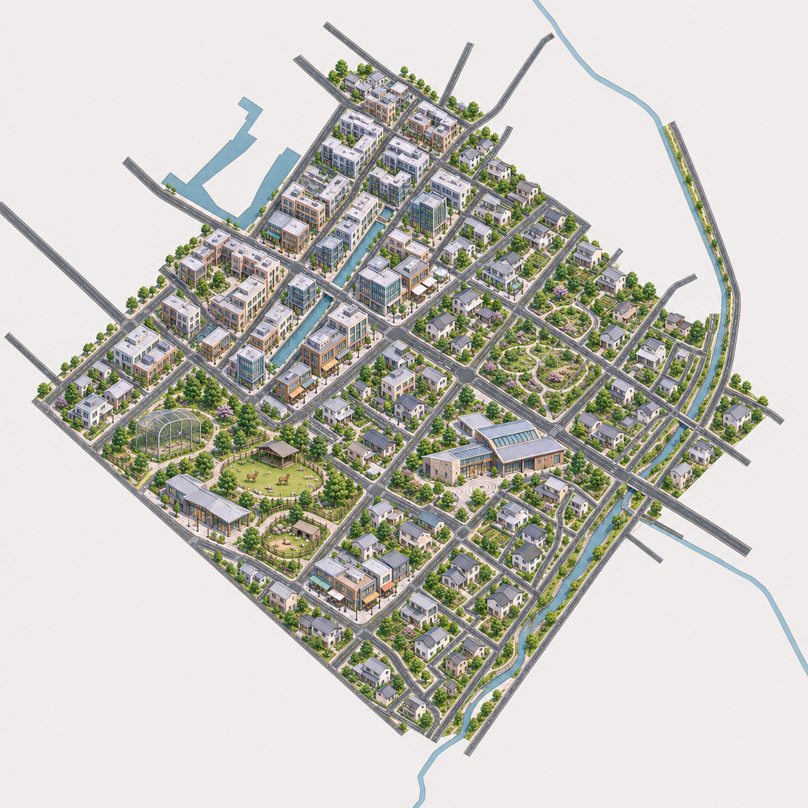

# 第6区 TR-24-v1：接续恢复交付

原对话实际已返回本张，但回复仍称等待且未归档。本次从原生输出目录恢复，逐字节复制，未重复生图。

自然科普／动物教育片区，原分区约28%繁华城区、71%郊区、不到1%外围。密集商住向低层庭院住宅过渡，动物教育园及自然科普馆在郊区。实际道路对应、接缝、蓝框位置及住宅面积比例未测；部分小屋仍有重复。

原生尺寸 (1254, 1254)，RGB，不透明。未解决高清、透明边缘或运行接入。等待用户逐张检查，不出第7张。

## 透视修订v2

用户圈注反馈已保存。内置原生编辑完成TR-24-v2.png，科普馆屋顶/立面、鸟舍和前景住宅有调整；局部细节也随编辑变化。不能宣称严格统一投影或配准通过，等待用户检查，不继续第7张。
