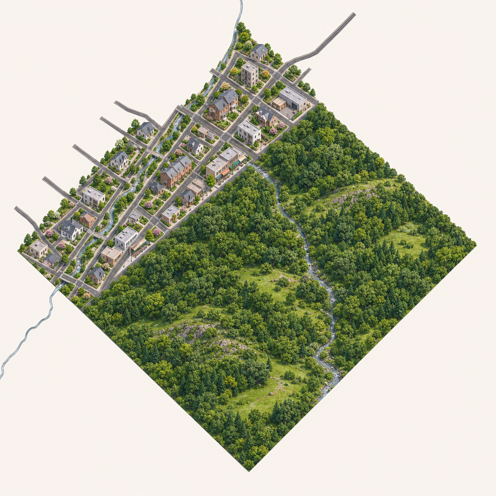
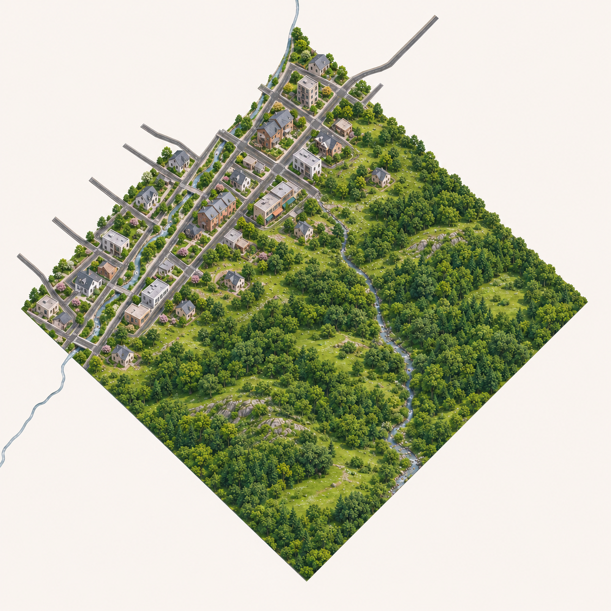
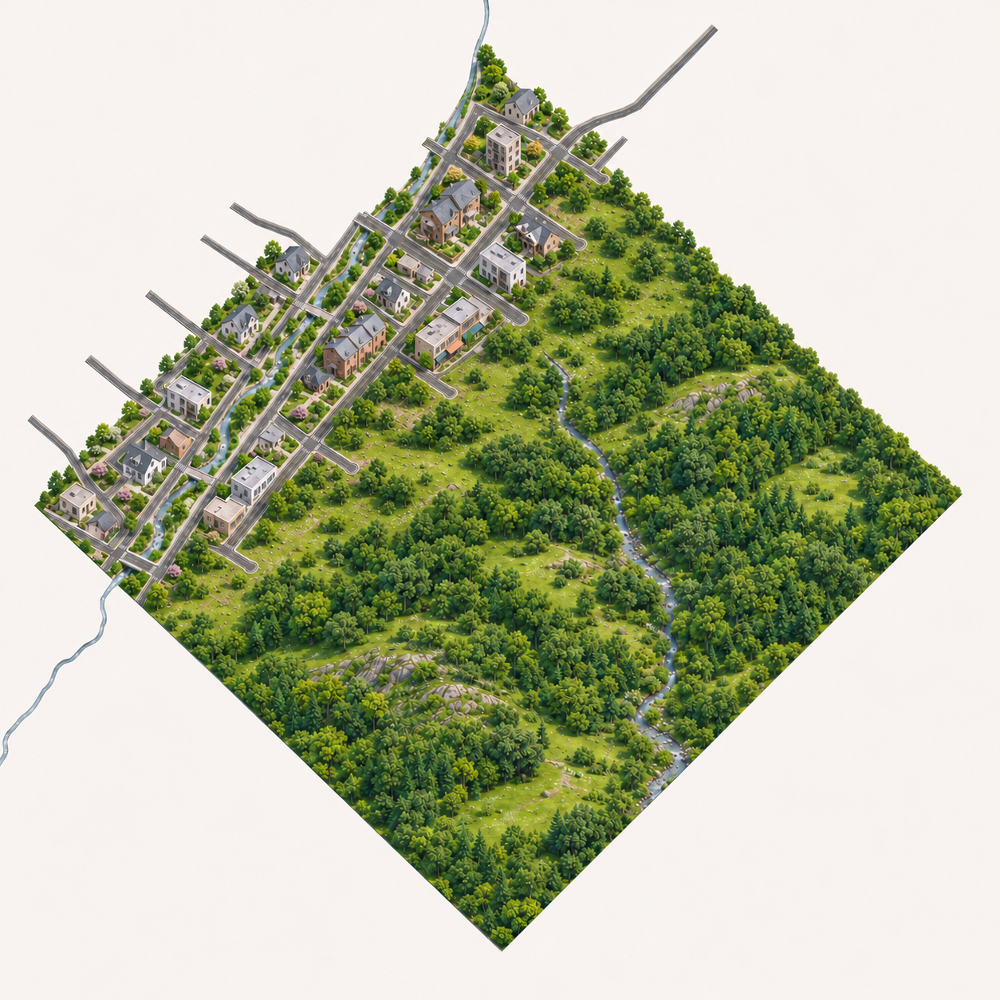

# 第7区 TR-25-v1 待审

TR24-v2获用户“继续吧，通过”后制作。西接TR24、南邻TR35，输入只含本区原路分区、用户原美术参考、金泽形态参考，没有完整AI邻图。

约28.37%郊区/71.63%非经营外围（源地面范围比例，非实际图像测量）。低层住宅服务街区过渡到树林草地低山原水系。树林绘制比建筑更写实、部分房屋仍偏高，交用户检查。

原生1254×1254 RGB不透明，未改像素。原路/边界/业务/存档不改；未配准、未运行接入，高清与接缝未解决。只生成本张，等用户检查，不出第8张。

## v2：城镇边缘参差渐疏候选

用户反馈边缘过齐，v2以分散住宅、草地空隙和不规则树丛形成过渡。原生1254RGB不透明，完整原文件另存。

**问题如实保留：** 外侧零散房屋可能超出原蓝框，部分边缘原路短支线在编辑后疑似缩短/省略；不能声称原路/边界落实完成。源city未修改，成图不ready。逐张交用户看，不自动再生。

## v3：保留渐疏方向，收回外侧房屋并补道路末端

用户对v2说“符合，继续”，只认可渐疏方向。此次v3移除外侧零散屋并补出部分横向道路末端，草地树丛过渡保留；末端改为圆头，精确源几何未验证，散落建筑比v2少，仍交用户检查。1254 RGB不透明原图逐字节保存，未ready或运行接入。

