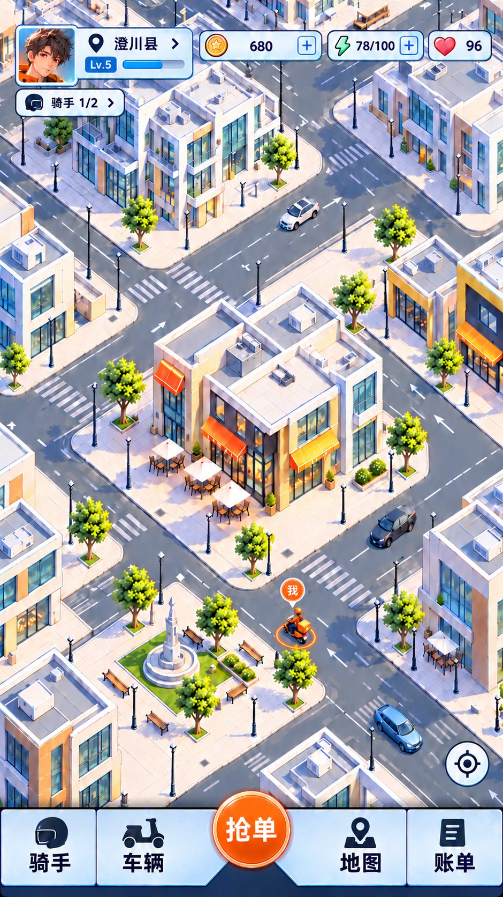
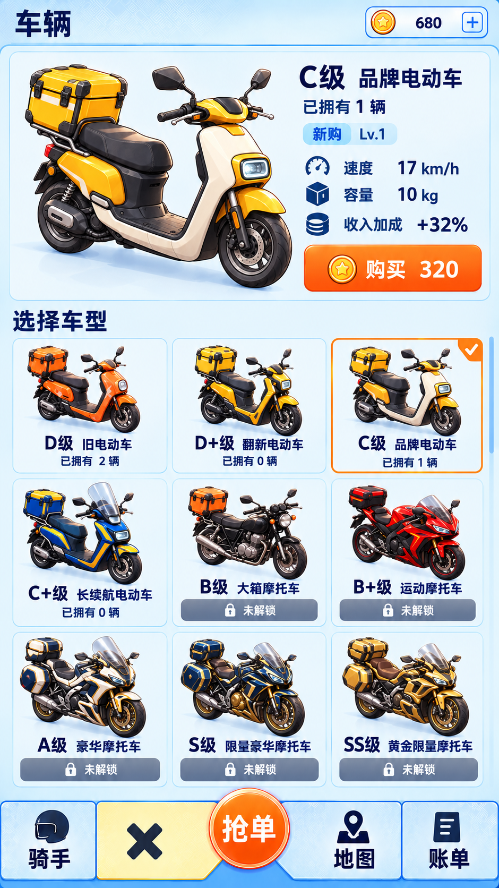
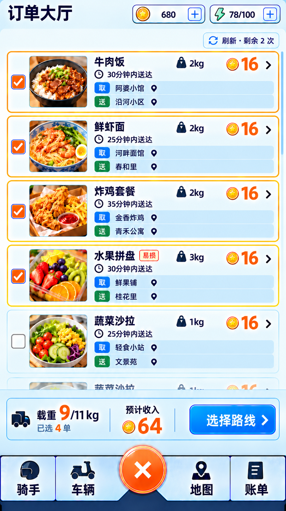
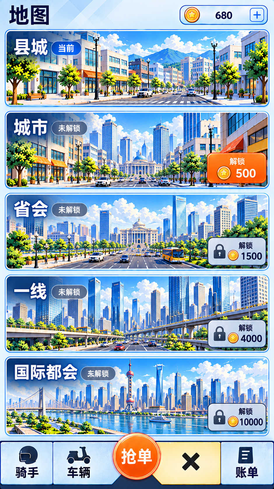
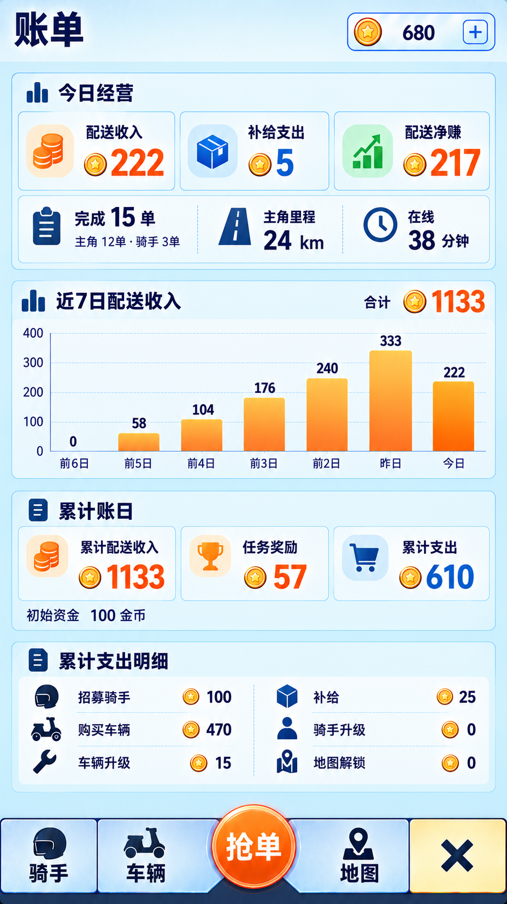

# 产品方案与已认可效果图：便捷查看

2026-11-03重新整理给用户。正式产品与已认可视觉保持原版本；没有重生或修改这批图片。8张原图本次SHA与认可记录全部一致。

## 产品资料

- [完整产品方案V1](2026-11-02-delivery-game-product-v1.md)
- [首版参数说明](../balance/2026-11-02-product-v1/parameters.md) · [完整参数JSON](../balance/2026-11-02-product-v1/parameters.json)
- [开发交接与阶段顺序](2026-11-02-delivery-game-development-handoff.md)
- [长期实施基准](implementation-baseline.md)

产品是竖屏都市外卖经营：亲送选单/路线/补给/交付，收入推动骑手招募、配车与升级、地图解锁；五图30名NPC加主角31人。完整规则以V1为准，参数是首版配置，尚未阶段实测。

## 已认可六页原图

| 首页 | 骑手 |
|---|---|
|  |  |

| 车辆 | 订单大厅 |
|---|---|
|  |  |

| 地图选择 | 账单 |
|---|---|
|  |  |

车辆补充：[锁定与原因](../art/2026-11-02-approved-ui-reference/02-vehicles-locked-v1.png)、[下方宫格滚动](../art/2026-11-02-approved-ui-reference/02-vehicles-gallery-scroll-v1.png)。完整来源、认可原话及SHA见[认可目录](../art/2026-11-02-approved-ui-reference/README.md)。[下载8张原图压缩包](../art/2026-11-02-approved-ui-reference.zip)，原始字节保留。

## 当前地图制作进度，单独查看

[打开二维拼装街角](http://127.0.0.1:4181/modular-city/) · [独立素材/版本](../art/2026-11-03-modular-city-assets/README.md) · [真实运行画面](../art/2026-11-03-modular-city-assets/engine-v3.jpg)。

这是首批方法样板，未用户美术验收，不能替代上方已认可画风或称整县地图完成。当前采用整栋透明图片如积木摆放、路网独立保留；树正视旧图被用户指出错误，已另存斜俯视修订并接入。仍有透视残差/精细遮挡/单帧骑手等限制。
